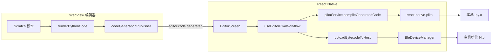

# PikaScript 编译与主机下发

本文档描述 Scratch 移动端已落地的两条链路：

- **轨道 A**：积木生成 Python，经 `react-native-pika` 编译为手机本地 `.py.o`。
- **轨道 B**：读取该字节码，经 BLE 上传到 Spark_AI 主机程序槽位。

原生编译器来自依赖 `react-native-pika`（`apps/mobile/package.json` 当前为 `0.1.1`）。本仓库没有 `packages/pika-bytecode/` 目录，不要按该路径查找 C/JNI 源码。

字节码校验、错误文案和工作流相位在 `packages/core/src/runtime/`。帧格式在 `packages/protocol`。连接与上传在 `apps/mobile/src/services/ble/`，详见 [ble-connection.md](./ble-connection.md)。

---

## 1. 整体链路



| 步骤 | 位置 | 说明 |
|------|------|------|
| 1 | `packages/scratch-editor-web/src/codegen/` | 积木工作区 → Python 源码 |
| 2 | `packages/scratch-editor-web/src/bridge/codeGenerationPublisher.ts` | 防抖后通过 `postMessage` 发送 `editor.code.generated` |
| 3 | `apps/mobile/src/screens/EditorScreen/EditorScreen.tsx` | 接收代码，交给 `useEditorPikaWorkflow` |
| 4 | `apps/mobile/src/services/pika/pikaService.ts` | 校验源码并调用 `react-native-pika` 的 `compile` |
| 5 | `packages/core/src/runtime/pika.ts` | 把原生结果映射为文案、字节数和 magic 预览 |
| 6 | `apps/mobile/src/services/ble/upload/service.ts` | 读取 `.py.o`，以 `{槽位}.o` 经 BLE 下发 |

代码发布有约 200ms 防抖。运行或下载读取的是当前已收到的 `generatedCode`，不会在编译前再向 WebView 要一次生成。刚改完积木就点运行，有可能用到上一份代码。

---

## 2. 目录与依赖

```
apps/mobile/src/services/pika/          # 编译适配：只调 react-native-pika
apps/mobile/src/services/ble/upload/    # 字节码上传到主机槽位
apps/mobile/src/features/editor/hooks/useEditorPikaWorkflow.ts
packages/core/src/runtime/pika.ts       # 文案、magic、可编译性判断
packages/core/src/runtime/pikaWorkflow.ts
packages/protocol/src/frames.ts         # 上传帧
```

`apps/mobile` 通过 `"react-native-pika": "0.1.1"` 使用原生模块。域逻辑不要直接依赖该包，放在 `packages/core`。

---

## 3. 字节码格式（`.py.o`）

编译产物是 **PikaScript 字节码**，不是 `.so`。

| 字段 | 值 |
|------|-----|
| Magic | `0x0f 0x70 0x79 0x6f`（`0x0f` + `"pyo"`，hex 前缀 `0f70796f`） |
| 默认文件 | `getDefaultBytecodePath()` 返回的本地 `pika-main.py.o`，每次编译覆盖 |

上传前 `readBytecodeFile()` 会检查这 4 个字节。不匹配则报「字节码格式无效，请重新编译」，不会把文件发给主机。

助手预览也会调用 `compileGeneratedCode`，但写入缓存目录后随即删除，不上传、不连接设备。

---

## 4. 业务封装 API（`pikaService`）

路径：`apps/mobile/src/services/pika/`。页面和服务层调用这里，不直接调 `react-native-pika`。

```typescript
import {
  compileGeneratedCode,
  readBytecodeFile,
  getDefaultBytecodePath,
  type PikaCompileOutcome,
} from '../../services/pika';
```

`PikaCompileOutcome` 定义在 `@scratch-mobile/core`：

```typescript
type PikaCompileOutcome = {
  ok: boolean;
  message: string;
  errorName?: string;
  phase?: 'compile' | 'execute' | 'bytecode' | 'io';
  output?: string;
  outputTruncated?: boolean;
  bytecodePath: string | null; // 成功时的绝对路径
  bytecodeSize: number;
  hexPreview: string;          // 前 16 字节 hex，正常以 0f70796f 开头
};
```

### `compileGeneratedCode(source, outputPath?)`

| 参数 | 说明 |
|------|------|
| `source` | Python 源码。先 `trim`，再交给 `isCompilablePythonSource()` |
| `outputPath` | 可选。省略时使用 `getDefaultBytecodePath()` |

以下内容不会送去编译，直接返回 `ok: false`、`message: '暂无有效 Python 代码'`：

- 空字符串
- 以 `//` 开头
- 以「拖拽飞出栏积木后生成 Python 代码」或「请从「当程序启动时」积木开始搭建程序」这两句占位注释开头

这不是 Python 语法分析。语法错误由原生编译器返回，再经 `mapPikaMessage()` 变成中文说明。

### `readBytecodeFile(path)`

读取编译产物并解码 `hex` 或 `base64`，通过 magic 校验后返回 `number[]`，供 BLE 上传使用。

```typescript
const compiled = await compileGeneratedCode(source);
if (!compiled.ok || !compiled.bytecodePath) {
  console.warn(compiled.message);
  return;
}
const bytes = await readBytecodeFile(compiled.bytecodePath);
```

---

## 5. 编辑器里的运行、下载和暂停

入口：`useEditorPikaWorkflow`。须已连接主机，否则弹窗提示，不编译。

| 操作 | 行为 |
|------|------|
| **运行** | 编译当前 Python，上传到所选槽位，末包功能码 `0xBC`（上传后运行） |
| **下载** | 同样编译并上传，末包功能码 `0xBB`（只保存） |
| **暂停** | `stopHostApp()`，发送 `app_stop`（`0xB9`）。不重新编译 |

槽位范围 0–10，主机文件名是 `{槽位}.o`，例如槽位 0 为 `0.o`。默认槽位是 0。

工作流相位在 `pikaWorkflow`：`idle → compiling → uploading → idle`。暂停走 `idle → running → idle`。非法转换会被忽略。弹窗只读 store 里的相位，不自己写状态。

`generatedCode` 变化时关闭进度弹窗。上一份编译结果不能直接当成新源码的产物再上传。

---

## 6. 上传帧

`uploadBytecodeToHost()` 要求蓝牙已连接，然后调用 `bleDeviceManager.uploadFile()`。分包在 `packages/protocol` 的 `buildUploadFrames()`，会话在 `UploadSession`：发出一帧后等待主机 ACK，校验通过才发下一帧。

| 帧 | 功能码 | 内容 |
|----|--------|------|
| 文件名 | `0xDA` | 主机文件名，如 `0.o` |
| 中间包 | `0xAA` | 最多 128 字节 |
| 结束包 | `0xBB` | 最后一包，上传后不运行 |
| 结束并运行 | `0xBC` | 最后一包，上传后运行 |

帧结构是 `5A 97 98`、长度、功能码、数据、低 8 位累加和、`A5`。没收齐的字节留在接收缓冲里。ACK 校验失败、超时或断连会取消本次上传。

---

## 7. 限制

含 `_motor`、`_matrix` 等硬件调用的程序，应在主机上执行。手机侧编译通常只做语法处理；编译成功不表示固件里一定有同名模块，也不表示硬件已接好。

`print()` 走 PikaScript 的平台输出，出现在系统日志里，不出现在 App 界面：

```bash
yarn logs:mobile
```

给 `EditorScreen` 新增 Hook 后，Fast Refresh 可能报 Hooks 顺序错误。需要完全重载 App（`yarn start --reset-cache` 或重新 `yarn android`）。

修改 `react-native-pika` 的原生代码后需要重新安装应用。该包的源码不在本仓库。

---

## 8. 相关文件

| 文件 | 职责 |
|------|------|
| [packages/scratch-editor-web/src/codegen/generators.ts](../packages/scratch-editor-web/src/codegen/generators.ts) | `renderPythonCode()` |
| [packages/shared/src/types/editorBridge.ts](../packages/shared/src/types/editorBridge.ts) | `editor.code.generated` |
| [apps/mobile/src/services/pika/pikaService.ts](../apps/mobile/src/services/pika/pikaService.ts) | 编译与读取字节码 |
| [packages/core/src/runtime/pika.ts](../packages/core/src/runtime/pika.ts) | magic、可编译性、错误文案 |
| [packages/core/src/runtime/pikaWorkflow.ts](../packages/core/src/runtime/pikaWorkflow.ts) | 编译 / 上传 / 暂停相位 |
| [apps/mobile/src/features/editor/hooks/useEditorPikaWorkflow.ts](../apps/mobile/src/features/editor/hooks/useEditorPikaWorkflow.ts) | 运行、下载、暂停 |
| [apps/mobile/src/services/ble/upload/service.ts](../apps/mobile/src/services/ble/upload/service.ts) | 槽位文件名与上传 |
| [packages/protocol/src/frames.ts](../packages/protocol/src/frames.ts) | 文件名帧与 128 字节分包 |
| [docs/ble-connection.md](./ble-connection.md) | 扫描、连接、Notify |
| [docs/blocks-python-codegen.md](./blocks-python-codegen.md) | 积木到 Python 的生成细节 |
